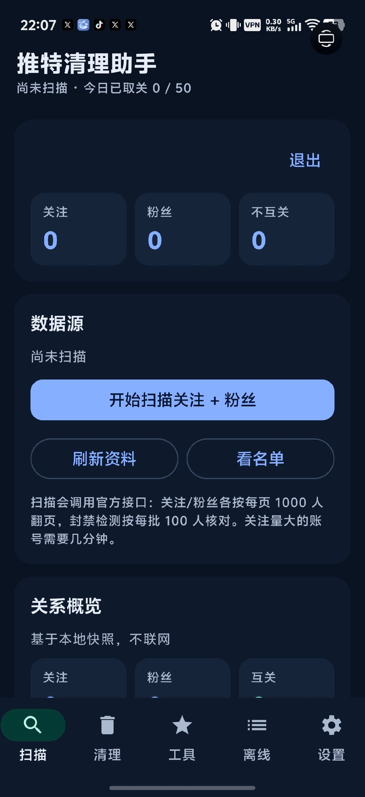
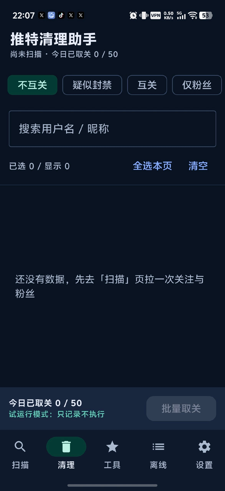
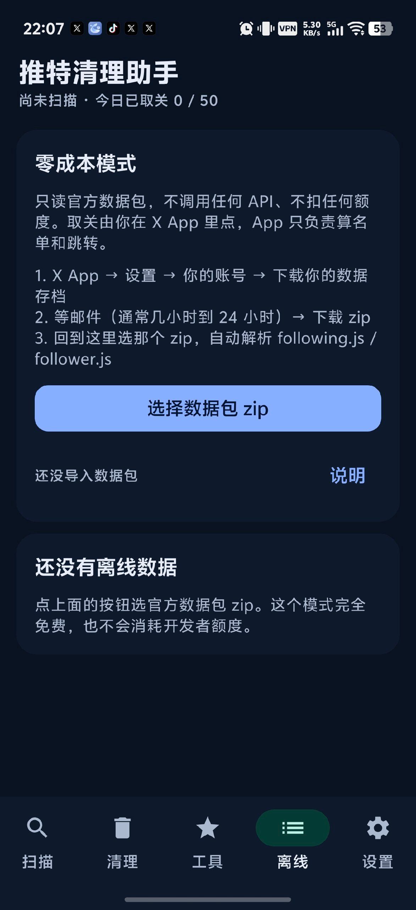
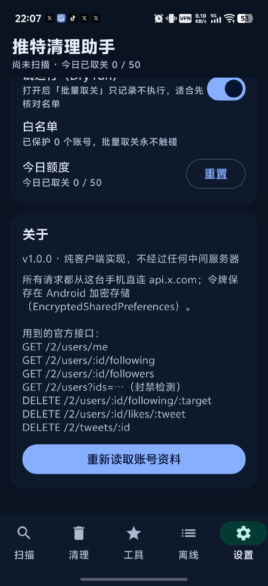

# TweetSweeper

[](LICENSE)
[](https://github.com/laosiji666/tweet-sweeper/releases)

An Android app (Kotlin + Jetpack Compose) to clean up your X (Twitter) account:
bulk unfollow, find non-follow-backs, detect suspended accounts, clear likes and reposts.

Two modes:

- **API mode** — OAuth 2.0 with PKCE against the official X API v2. Needs your own
  developer app Client ID (`tweetsweeper://callback` as redirect URI).
- **Offline mode** — no API, no cost: import your official X data archive
  (`following.js` / `follower.js`), compute the lists locally, then tap to open each
  profile in the X app and unfollow manually. Tracks what you already handled.

**[⬇ Download the latest APK](https://github.com/laosiji666/tweet-sweeper/releases/latest/download/TweetSweeper.apk)**

Android 8.0+ · ~7.6 MB · no server, tokens stored in Android Keystore–backed storage.

## Screens

| Scan | Clean |
|---|---|
|  |  |

| Tools | Offline |
|---|---|
|  |  |

| Settings |
|---|
|  |

## Build

```bash
git clone https://github.com/laosiji666/tweet-sweeper.git
cd tweet-sweeper
./build.sh      # or: ./gradlew assembleDebug
```

Requires JDK 17 and Android SDK (platform 35, build-tools 35).

## Notes

- Since April 2026, X removed follow/like write endpoints from every self-serve tier
  (Enterprise only). API-mode unfollow therefore returns 403 on self-serve plans;
  offline mode is unaffected.
- Everything runs on-device. No telemetry, no backend.

MIT licensed. 中文说明见 [README.md](README.md).
