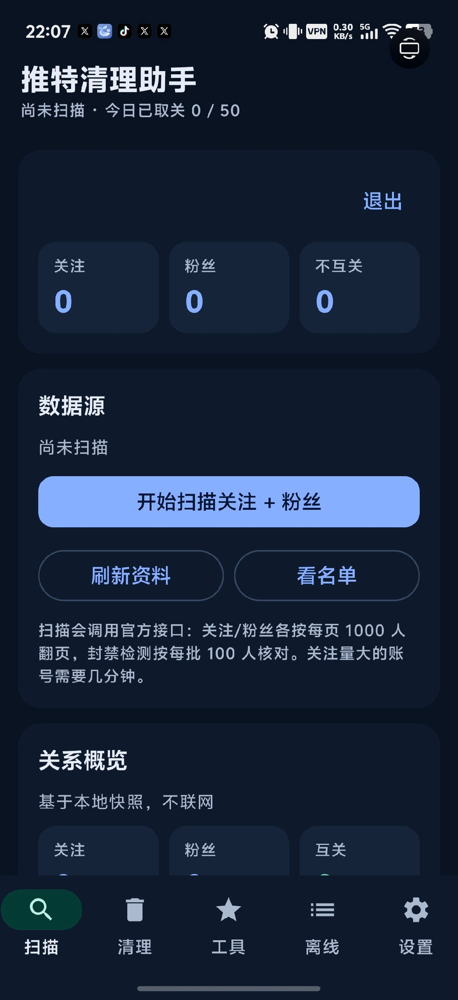
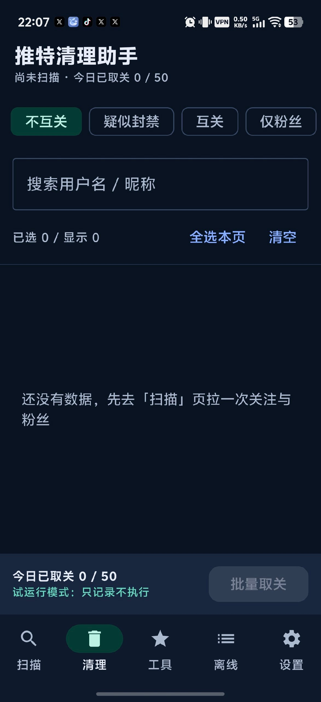
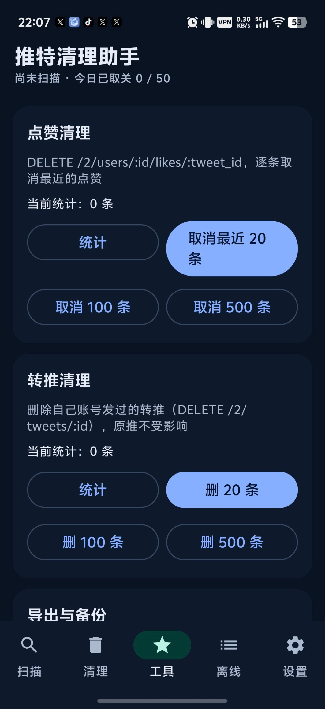
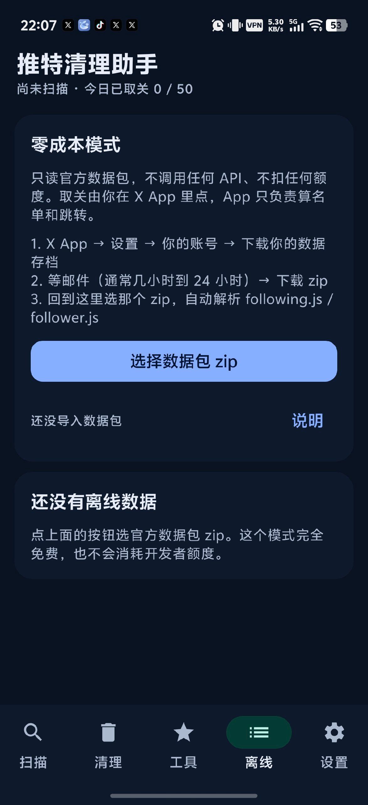
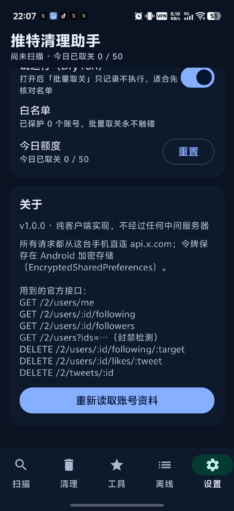

# 推特清理助手 · TweetSweeper

[](LICENSE)
[](https://github.com/laosiji666/tweet-sweeper/releases)
[](https://developer.android.com)

Android 原生 App（Kotlin + Jetpack Compose）。用 **X 官方 OAuth 2.0（Authorization Code + PKCE）** 授权后，做批量取关、找不互关、封禁检测、点赞/转推清理；另有一个**不调用任何 API 的离线模式**：读官方数据包，本地算名单，一键跳转 X 主页手动取关。

- 包名 `com.yg.tweetsweeper`，minSdk 26 / targetSdk 34 / compileSdk 35
- 无中间服务器，令牌用 Android Keystore 加密保存在本机

## 下载

**[⬇ 下载最新版 TweetSweeper.apk](https://github.com/laosiji666/tweet-sweeper/releases/latest/download/TweetSweeper.apk)**

- 系统要求：Android 8.0（API 26）及以上，约 7.6 MB
- 首次安装需要在系统里允许“安装未知来源应用”
- 签名证书 SHA-256（可用 `apksigner verify --print-certs` 核对）：

```
a94a3126b12577abba25b40d51a920330a2392dfd0c8d74b9faa603e4b030ed9
```

## 界面

| 扫描 | 清理 |
|---|---|
|  |  |

| 工具 | 离线 |
|---|---|
|  |  |

| 设置 |
|---|
|  |

> 截图里的账号信息已打码。

## 功能

| 模块 | 说明 | 接口 |
|---|---|---|
| 关系扫描 | 抓取全部关注 + 粉丝，本地比对 | `GET /2/users/:id/following`、`/followers` |
| 不互关 | 你关注了对方、对方没回关 | 本地集合运算 |
| 仅粉丝 | 对方关注你、你没回关 | 同上 |
| 封禁/注销检测 | 批量核对，标记已停用、已消失 | `GET /2/users?ids=…`（每批 100） |
| 批量取关 | 勾选/全选，白名单、每日上限、随机间隔、试运行 | `DELETE /2/users/:id/following/:target` |
| 点赞清理 | 统计并取消最近 N 条点赞 | `DELETE …/likes/:tweet` |
| 转推清理 | 删除自己的转推（原推不受影响） | `DELETE /2/tweets/:id` |
| **离线模式** | 解析官方数据包 `following.js` / `follower.js`，零 API 算名单 | 无 |
| 导出 | CSV（关系 + 状态），走系统文件选择器 | 本地 |
| 安全 | 白名单、Dry run、每日配额、操作历史、加密存储 | 本地 |

### 零成本模式（离线页）

不需要 Client ID、不花一分钱：

1. X App → 设置 → 你的账号 → **下载你的数据存档**
2. 收到 zip 后，在「离线」页点「选择数据包 zip」
3. 自动解析 `data/following.js` / `data/follower.js`（只读 `accountId`），本地算出不互关 / 互关 / 仅粉丝
4. 点「打开」→ 跳 `https://x.com/i/user/<id>` → X App 打开对方主页，手动取消关注
5. 点过的自动标记**已处理**并从列表移除，顶部显示「待处理 N · 已处理 M · 已保留 K」，可撤销、可重置
6. 每行有「保留」按钮，一键加入白名单；`隐藏已保留` 可把保护对象从列表里收起来
7. 打开「显示已处理」时，已取关的按时间倒序排列：最后取关的在最上面、最早的在最下面
8. 列表右侧有可拖动的快速滚动条，1500+ 条也能一拖到底

限制：数据是快照（取关后需重新导出）；包内没有用户名与封禁状态。

## X 开发者后台配置（API 模式才需要）

1. 打开 <https://developer.x.com> → 创建 Project + App
2. App → **User authentication settings** → Set up：
   - App permissions：`Read and write`
   - Type of App：**Native App**（public client，不需要 client secret）
   - Callback URI：`tweetsweeper://callback`
   - Website URL：任意合法地址
3. 复制 **OAuth 2.0 Client ID**（不是 API Key），填进 App 后点授权

申请的 scope：

```
tweet.read users.read follows.read follows.write like.read like.write offline.access
```

## 编译

```bash
git clone https://github.com/laosiji666/tweet-sweeper.git
cd tweet-sweeper
./build.sh            # 自动挑 JDK、缺失时生成签名密钥、编译 release
# 产物 app/build/outputs/apk/release/app-release.apk
```

或 `./gradlew assembleDebug`。需要 JDK 17 + Android SDK（platform 35、build-tools 35）。

> 在 aarch64 Linux（例如 proot 里的 Ubuntu）上构建时，需要把 `android.aapt2FromMavenOverride` 指向 aarch64 版 aapt2，官方只发 x86_64。

## 发版

```bash
# 1. 改代码、提交
git commit -am "feat: ..."
# 2. 打 tag 并推送，CI 自动构建签名包 + 发布 Release
git tag v1.2.3 && git push origin v1.2.3
```

版本号由 tag 推导（`v1.2.3` → versionName `1.2.3`、versionCode `10203`），签名密钥存在仓库 Secrets 里，构建完自动上传 `TweetSweeper.apk` 到 Release。推 `main` 只跑测试和 debug 包，不占发版号。

## 目录结构

```
app/src/main/java/com/yg/tweetsweeper/
├── MainActivity.kt          接收 OAuth 回调（tweetsweeper://callback）
├── net/
│   ├── Models.kt            接口模型 + 错误映射
│   ├── RateGate.kt          限速闸门（x-rate-limit-*，满额自动等待）
│   └── XApi.kt              API 封装（401 刷新、429 排队重试）
├── auth/
│   ├── Pkce.kt              PKCE + 授权 URL
│   └── AuthRepository.kt    令牌交换/刷新/加密存储
├── data/
│   ├── AppStore.kt          快照、白名单、历史、配额
│   └── ArchiveImporter.kt   官方数据包解析
├── vm/
│   ├── MainViewModel.kt     API 模式状态机
│   └── LocalViewModel.kt    离线模式状态机
└── ui/                      Compose：扫描 / 清理 / 工具 / 离线 / 设置
```

## 限速（官方硬限制）

- 关注/粉丝列表：15 次 / 15 分钟，每页最多 1000 人
- 用户批量查询：封禁检测用，每批 100 个 id
- 写入类（取关/取消点赞/删推）：另有更严窗口，`remaining` 归零时 App 自动等到窗口重置
- 本地另有每日取关上限（默认 50，可调 1–200）与随机间隔（默认 1.5–3.5 秒）

## 注意

- 2026 年 4 月起，X 把关注/取关/点赞等写接口从所有自助档位移除，仅 Enterprise 可用；API 模式取关会返回 403。零成本模式不受影响。
- 取关不可批量撤销，先用试运行核对名单，重要账号加白名单。
- 扫描结果存在本机 `filesDir/snapshot.json`，换设备需重新扫描。
- 退出登录只清令牌，不清快照。

## 隐私

- 没有服务器、没有统计 SDK、没有崩溃上报
- 令牌存在 Android 加密存储（EncryptedSharedPreferences），卸载即清除
- 名单、快照、白名单、处理标记只写本机
- 官方数据包由用户手动导入本地解析，不上传
- 仓库不含任何密钥、令牌、账号信息

## 协议

[MIT](LICENSE) © 2026 YG
